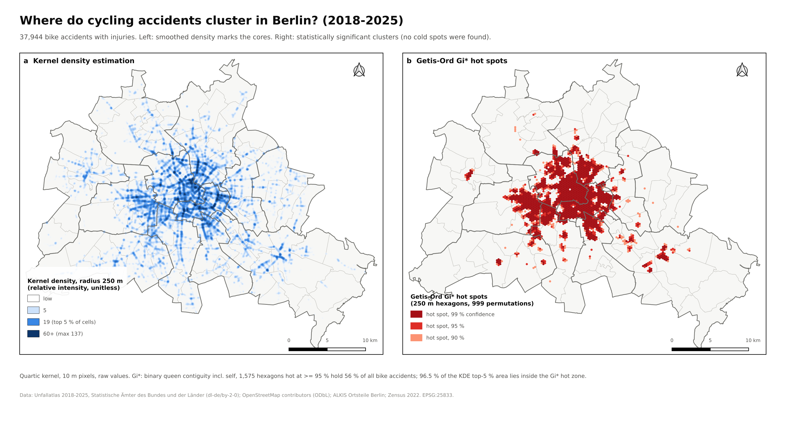

# Project 4 – Cycling Accident Hotspots with PostGIS (Berlin)

**Status:** complete (Parts A to H; optional QField part skipped)
**Tools:** PostgreSQL 18.6 + PostGIS 3.6 on Amazon RDS · QGIS 4.2 (print layouts, Temporal Controller API, qgis_process) · QGIS Server 4.2 in Docker (WMS, OGC API – Features) · qgis2web 4.4 · Python (PySAL esda/libpysal, geopandas, psycopg, matplotlib)
**Question:** Where and when do cycling accidents cluster in Berlin, and has the situation improved from 2018 to 2025?

The results count **police-recorded accidents with injuries**. There is no cycling-volume (exposure) data, so they show where and when accidents happen, not the risk per kilometre cycled.

## Data

| Data | Source | Notes |
|---|---|---|
| Accidents with injuries 2018–2025 | Unfallatlas, Statistische Ämter des Bundes und der Länder, https://www.opengeodata.nrw.de/produkte/transport_verkehr/unfallatlas/ (dl-de/by-2-0) | One Germany-wide CSV per year, filtered to Berlin (ULAND 11): 100,546 rows. |
| Road network | © OpenStreetMap contributors, Geofabrik Berlin extract of 2026-11-02 (ODbL) | Reused from Project 1. |
| Ortsteile (97) | ALKIS Berlin, via Project 1 | Bezirk derived from the key. |
| Population, 100 m grid | Zensus 2022, via Project 1 (dl-de/by-2-0) | 3,595,261 residents in 40,662 cells. |

**CRS trap:** the Unfallatlas LINREFX/LINREFY columns are in ETRS89/UTM **zone 32** (EPSG:25832), although Berlin lies in zone 33. Geometry was built from the WGS84 columns, which use decimal commas, and transformed to EPSG:25833. Checked: the official coordinates read as 25832 match to 0.00 m, while misread as zone 33 they land 407 km away.

All analysis is in EPSG:25833. Every query is kept as a file in `sql/`.

## Work completed

**A. Database.** The project started in a local PostGIS Docker container and was then moved, at the user's choice, to **Amazon RDS for PostgreSQL** (eu-north-1, db.t4g.micro, Single-AZ, 20 GB gp3, encrypted, deletion protection, 1-day backups as the free plan allows).
- The master password is managed by Secrets Manager and kept in `~/.pgpass`. It never appears in the project, git or the chat.
- Connections use TLS 1.3 with `sslmode=verify-full` against the RDS CA bundle (`rds.force_ssl=1`).
- The port is **15432**, not 5432, because the local network path blocks outbound 5432.
- All SQL ran unchanged on RDS and reproduced the local checkpoint numbers exactly.
- Foreign keys link every derived table to its source, and all were validated (`sql/c5_foreign_keys.sql`).

**B. Accident data.** Eight yearly files were harmonised by column **name**, because column order, names, encodings and BOMs change between years (`_work/b2_harmonise.py`).
- 100,546 Berlin rows were loaded with check constraints. 100,535 fall inside Berlin; the 11 dropped points lie 0–10.6 m outside the boundary.
- **37,944 involve a bicycle (37.7 %).**

| Year | 2018 | 2019 | 2020 | 2021 | 2022 | 2023 | 2024 | 2025 |
|---|---|---|---|---|---|---|---|---|
| Bike accidents | 5,191 | 5,005 | 5,108 | 4,293 | 4,657 | 4,471 | 4,452 | 4,767 |
| Share of all injury accidents | 38.0 % | 37.4 % | 43.3 % | 38.0 % | 37.7 % | 36.3 % | 35.8 % | 35.9 % |

**C. Road network and snapping**
- **Roads:** 232,423 OSM lines, using the brief's classes plus footways and paths signed for bicycles (see Deviations).
- **Segments:** roads were clipped to Berlin and split into equal pieces of at most 100 m, giving **285,046 segments** (12,989 km).
- **Snapping:** each bike accident was snapped with KNN (`<->`) to the nearest segment within 25 m. 37,920 of 37,944 matched. Of the 24 unmatched, 17 were 25–50 m away. The median snap distance is 0.66 m and p99 is 5.34 m.
- **Statistics per segment:** accidents in total and per year, killed or seriously injured (KSI), and accidents per km. 22,127 segments (7.8 %) have at least one accident.

**D. Hotspots**
- **KDE:** quartic kernel, radius 250 m, 10 m pixels (`data/kde_bike_r250_p10.tif`).
- **Hexagon grid:** 250 m centre spacing, 17,000 hexagons, each point counted once. QGIS and PostGIS define "hexagon size" differently; the PostGIS hexagons would be 3 times larger. QGIS's definition was used (`ST_HexagonGrid(250/√3)`).
- **Getis-Ord Gi\*:**
  - **Method:** binary queen contiguity including the hexagon itself, 999 permutations, run on complete hexagons so that edge hexagons do not look artificially cold.
  - **Hot spots:** 1,283 at 99 %, 292 at 95 % and 212 at 90 % confidence.
  - **Concentration:** the **1,575 hexagons hot at 95 % or more cover 9.6 % of Berlin but hold 56.4 % of all bike accidents**.
  - **No cold spots:** the counts are zero-inflated (63 % of hexagons are zero), so low values cannot reach significance.
  - **Robustness:** 1,135 hexagons stay hot after an FDR correction.
- **KDE vs Gi\*:** 96.5 % of the KDE top-5 % area lies inside the Gi\* hot zone, but it covers only 31 % of that zone. KDE marks the cores; Gi\* marks the wider significant area.
- **By Bezirk:** Mitte has 414 hot hexagons, Friedrichshain-Kreuzberg 299 and Charlottenburg-Wilmersdorf 218. Marzahn-Hellersdorf has none.

**E. Temporal patterns** (`output/e*.png`, `output/e*.csv`)
- **Trend:** 2018 → 2025 is **−8.2 %** (−9.6 % comparing 2018/19 with 2024/25). 2020 is a COVID outlier, with a bike share of 43 % because car traffic fell.
- **By Bezirk:** clear falls in the centre (Charlottenburg-Wilmersdorf −18 %, Mitte −16 %, Pankow −15 %, Friedrichshain-Kreuzberg −13 %, comparing 2018/19 with 2024/25). Rises in Treptow-Köpenick (+8 %), Spandau (+2 %) and Neukölln (+1 %).
- **Severity:** the share of killed or seriously injured fell from 14.3 % to 11.7 %. Deaths per year: 10, 6, 17, 8, 11, 10, 8, 4, which are too few to show a trend.
- **When:** the peaks are weekday commuting hours, with Tuesday and Thursday 16:00 highest, followed by 08:00. Monday to Friday account for 84 % of accidents. 80 % happen in daylight.
- **Animation:** built with the QGIS temporal API in accumulate mode (`output/e3_bike_accidents_by_year.gif`).

**F. Normalisation** (`output/f1_ortsteil_stats.csv`, `output/f2_top20_segments.csv`)
- **Ortsteile:** the counts were computed as absolute numbers, per 10,000 residents per year and per road km per year (with and without service roads).
  - The rankings agree only partly (Spearman ρ: absolute vs per-resident 0.41, absolute vs per-km 0.73).
  - Per resident, small or commuter-centre Ortsteile come out on top, such as Stadtrandsiedlung Malchow (1,059 residents) and Tiergarten. Eight Ortsteile with fewer than 5,000 residents are flagged.
- **Top 20 segments by accidents per km:** only segments of at least **50 m** are ranked. Without that rule, all of the top 20 are junction stubs under 50 m, the shortest only 1.9 m.
  - **Leaders:** rank 1 is Invalidenstraße in Mitte (38 accidents on 76 m, 498/km), followed by Petersburger Straße and Unter den Linden.
  - **Gi\* overlap:** 18 of the 20 lie in a Gi\* hot spot. The other two, rank 5 Heinrich-Mann-Straße and rank 15 Am Wasserwerk, are isolated single-site hotspots that a neighbourhood statistic smooths away.
  - **Parallel lines:** two sites appear twice (ranks 14/17 and 18/20) because OSM maps a dual carriageway or a separate cycle track as parallel lines.

**G. Publishing**
- **Read-only role:** `p4_reader` has SELECT only. Writes are blocked twice over, by a read-only default transaction and by missing privileges, and both were tested. Its password lives only in a libpq service and passfile outside the repo.
- **QGIS Server 4.2 (Docker):** serves `p4_server.qgz` as WMS and OGC API – Features (`/ogc/p4_server.qgz/ogcapi`). Feature counts were checked against the database and the services loaded back into QGIS as a client.
  - **FastCGI pitfall:** FastCGI replaces the process environment per request, so `PGSERVICEFILE` is lost. The service file is therefore mounted as `~/.pg_service.conf`.
- **qgis2web:** a static Leaflet map in `output/web/`, with the 1,787 significant hexagons, the top 20 segments with popups, attribution and no credentials. It was run headless, and four failed exports are kept in `_work/web_v1..v4` to show the debugging. Serve it over http, because under `file://` the OSM tiles return 403.

**H. Maps** (QGIS print layouts rendered headless, 200 dpi)
- **Map 1 (`output/h1_hotspots.png`):** KDE and Gi\* side by side on the same extent. Overlaying them would mix the two colour ramps.
- **Map 2 (`output/h2_top20_segments.png`):** the top 20 segments with a table and notes.
- **Map 3 (`output/h3_ortsteil_normalisation.png`):** the same accidents shown three ways (absolute, per resident, per road km), with quantile classes per panel.
- **Map data:** read from a local, count-checked copy of the RDS layers (`data/map_layers.gpkg`), because the VM's connection drops intermittently.

## Deviations from the brief

- **Roads:** footways, paths, pedestrian areas, bridleways and tracks signed `bicycle=yes/designated` are included (1,409 km before clipping) because people cycle on them. The `road_class` field allows them to be filtered out. Service roads are kept, including driveways and parking aisles, which is why the top-20 ranking needs a minimum length.
- **Gi\*:** computed with PySAL (esda 2.10) in a separate virtual environment, not with a QGIS plugin. The results match the textbook Gi\* formula to 7e-15.
- **Database:** Amazon RDS instead of local Docker, on port 15432.
- **QField:** skipped, because QFieldSync is not yet available for QGIS 4.2.

## Assumptions and limits

- **No exposure data:** Berlin cycling grew over the period, so falling counts do not mean falling risk. Per-km rates are per km of **road**, not per km **cycled**.
- **Recorded accidents only:** Unfallatlas contains only police-recorded accidents with injuries. Damage-only and unreported accidents are missing.
- **Junction accidents:** these sit on the junction node and fall to whichever touching segment is nearest. As a result, short segments at junctions collect them.
- **Tuning choices:** the Gi\* results depend on the hexagon size (250 m) and the neighbourhood (queen, 6 neighbours). A 500 m distance band would give 18 neighbours and a smoother pattern.
- **Data vintages differ:** OSM is from 2026, while the accidents run 2018–2025, so streets rebuilt during the period are matched to today's geometry.

## Skills practised

- **PostGIS:** schema design with constraints and foreign keys, KNN snapping (`<->` with LATERAL), `ST_LineSubstring` segmentation, `ST_HexagonGrid`, spatial joins and aggregation, views for publishing.
- **Spatial statistics:** kernel density, Getis-Ord Gi\* with permutation inference and FDR, comparison of methods, the modifiable areal unit problem in normalisation.
- **Data engineering:** harmonising inconsistent yearly files, catching a CRS trap, reproducible SQL files, checkpoint counts at every step.
- **Cloud database:** RDS setup with least-privilege networking, TLS verify-full, Secrets Manager, a read-only role, and diagnosing a blocked port and a rotating client IP.
- **Publishing:** QGIS Server in Docker (WMS, OGC API – Features), qgis2web, headless QGIS print layouts and temporal animation.

## CV-ready bullets

- Built a PostGIS database on Amazon RDS (TLS verify-full, least-privilege roles) of 37,944 Berlin bike accidents (2018–2025) and snapped 99.94 % of them with KNN to 285,046 road segments of at most 100 m.
- Found statistically significant accident clusters with Getis-Ord Gi\* (PySAL, 999 permutations) on a 250 m hexagon grid. 9.6 % of the city's area holds 56 % of bike accidents. Validated the clusters against kernel density and an FDR correction.
- Published the results as WMS and OGC API – Features from QGIS Server in Docker through a read-only database role, and as a static qgis2web map.
- Showed how per-resident and per-road-km normalisation reorder the Ortsteil rankings (Spearman 0.41–0.73) and ranked dangerous segments only above a minimum length, so that junction-stub artefacts are excluded.

## Outputs

- `output/p4_handout.pdf`: 12-page A4 handout (findings, maps, charts, animation frames, tables, web map screenshots).
- `output/h1_hotspots.png`, `output/h2_top20_segments.png`, `output/h3_ortsteil_normalisation.png`: Maps 1–3 (200 dpi PNG), plus the same maps as vector PDFs (`output/h1_hotspots.pdf`, etc.).
- `output/e1_trend_city.png`, `e1_trend_bezirk.png`, `e2_hour_weekday.png`, `e4_severity.png`: charts. `output/e3_bike_accidents_by_year.gif` and `output/e3_frames/`: animation.
- `output/*.csv`: trend, hour × weekday, light, severity, Ortsteil statistics, top 20 segments.
- `output/web/`: qgis2web map. To view it, run `python3 -m http.server` in that folder. Screenshots: `output/web_map_overview.png`, `output/web_map_popup_rank1.png`.
- `p4.qgz`: working project (database connection only, no password). `p4_server.qgz`: QGIS Server project (service `p4_reader`).
- `sql/`: all SQL in run order (a0 → f2). `_work/`: Python scripts and logs. `WORKLOG.md`: step-by-step record, including failures and decisions.
- `data/`: harmonised CSV, KDE raster, local GeoPackages for rendering. The raw Unfallatlas zips and `.tif` files are not in git (see `.gitignore`); `_work/b1_download.sh` downloads the zips again.

**Reproducing:** the database lives on RDS. If the instance is stopped or deleted, QGIS Server and the `.qgz` projects lose their data source. The qgis2web map, the PNG maps and the CSVs do not need it. To rebuild the database, run the SQL files in order against any PostGIS 3.5+ database.
