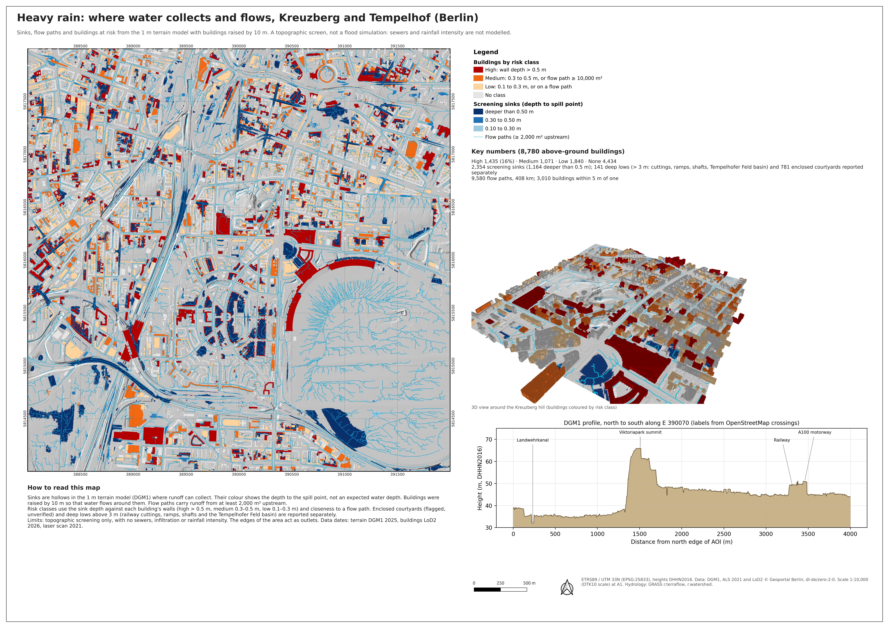

# Project 3 – Terrain, Heavy Rain and 3D City (Berlin)

**Status:** complete (Parts A to H)
**Tools:** QGIS 4.2 · GRASS 8.5 (r.terraflow, r.watershed) · PDAL 2.10 · GDAL · Qgis2threejs 3.3 · Python (rasterio, geopandas, NumPy)
**Question:** Which buildings sit in surface-runoff sinks or on flow paths during heavy rain, based on terrain alone?

This is a **topographic susceptibility screen, not a hydrodynamic flood simulation**. Sewers, infiltration and rainfall intensity are not modelled. Sink depths are depths to the spill point, not expected water depths.

## Area of interest

E 388000–392000, N 5814000–5818000 (EPSG:25833), 4 × 4 km, the four official 2 km DGM1 tiles over Kreuzberg hill (Viktoriapark, 66 m), Bergmannkiez, the Landwehrkanal and much of Tempelhofer Feld. The point cloud work uses the 1 km ALS tile 390_5816 on the Kreuzberg hill.

## Data (all dl-de/zero-2-0, Geoportal Berlin)

| Data | Source | Notes |
|---|---|---|
| DGM1 terrain, 1 m | ATOM https://gdi.berlin.de/data/dgm1/atom/ (updated 2025-12-18) | xyz in 2 km tiles, heights DHHN2016 |
| ALS point cloud 2021 | ATOM https://gdi.berlin.de/data/a_als/atom/ (updated 2025-08-07) | LAS 1.4 in district zips of 1–51 GB; one 1 km tile pulled out by HTTP byte ranges. The November 2025 flight is not yet published. |
| LoD2 buildings | ATOM https://gdi.berlin.de/data/a_lod2/atom/ (updated 2026-03-26) | CityGML 1.0, 1 km tiles, ETRS89/UTM33 + DHHN2016 |
| Population 100 m (reused) | Zensus 2022 via Project 1 | dl-de/by-2-0 |
| Roads and water (checks only) | © OpenStreetMap contributors | ODbL |
| Orthophoto 2024 (checks only) | Geoportal Berlin WMS | |

Heights are DHHN2016 (EPSG:7837), physical heights above the geoid. They were never mixed with ellipsoidal heights, which differ by about 40 m in Berlin.

## Work completed

**A. Setup.** AOI and tile index in `data/p3.gpkg`. Feeds checked for tile names, update dates and a newer ALS release.

**B. Data preparation**
- DGM1 mosaic `data/dgm1_aoi.tif`: 4000 × 4000 px, 1 m, 100% valid, heights 28.89–67.01 m. The xyz rows run south to north, so the mosaic was rebuilt north-up with gdalwarp.
- ALS tile: 13,734,030 points. The header has no CRS (point format 6 without the WKT flag), so EPSG:25833+7837 was assigned from the feed.
- LoD2: 10,168 buildings with footprints from GroundSurface polygons. `measuredHeight` is not in the data, so height = roof top minus lowest ground vertex.
- 1,284 canopies and 124 underground objects are excluded from the hydrology.

**C. Terrain analysis**
- Multidirectional hillshade, slope, aspect, and 41,531 contours (1 m, with 5 m index).
- Slope: 58% of the AOI is under 2°, 1.2% steeper than 30°.
- N–S profile through the hill, with labels from OSM crossings (`output/profile_ns.png`).

**D. Heavy-rain hydrology**
- Buildings raised by +10 m. Depressions filled with r.terraflow; r.fill.dir did not converge on this DEM.
- 2,506 sinks of at least 0.10 m depth and 50 m², classed by how much of their rim is building:

| Sink class | Count | How it is used |
|---|---|---|
| Open terrain | 1,048 | Screening |
| Partly building-bounded | 665 | Screening |
| Enclosed by buildings | 781 | Separate "courtyard, unverified" flag. With buildings raised they fill to about 10 m, but on terrain alone they are 0.86 m (median). |
| Water | 12 | Excluded |

- 141 sinks deeper than 3 m are reported separately as **deep lows**. Most are engineered (railway cuttings, car-park ramps, light wells, shafts; the deepest were checked on aerial photos). The largest is not: a 75.6 ha open basin on Tempelhofer Feld, 3.6 m to its spill point (mean 1.45 m), with no buildings on its rim, so it does not change the building results.
- Flow paths: r.watershed with at least 2,000 m² upstream gives 9,580 lines (408 km). 67% run within 10 m of a road or path, against 54% of the area.

**E. Point cloud (tile 390_5816), rasterised with PDAL binning on an exact 1 m grid**
- **Classification:** the product has no building class. 93% of points on LoD2 roofs are class 5, so class 5 holds roofs as well as high vegetation, and the canopy model excludes footprints and anything above 40 m.
- **Density:** 13.73 points/m² in total, 10.24 first returns/m² (pulse density, close to the stated 9.8), 5.63 ground points/m².
- **ALS DTM vs DGM1:**

| Measure | Value |
|---|---|
| Cells compared | 677,924 |
| Median difference | 0.000 m |
| NMAD | 0.015 m |
| Within ±0.05 m | 93.5% of cells |
| Mean | +0.019 m |
| RMSE | 0.268 m |

  The RMSE comes from a few outliers: vegetation, steep slopes, and two local changes since 2021 (one block about +0.5 m, one spot −7.1 m). See `output/dtm_difference_als_dgm1.png`.

**F. 3D buildings**
- **Height QA:** for 983 buildings fully inside the tile, LoD2 roof top minus ALS DSM p95 in the footprint (eroded 1 m) gives median −0.16 m and MAE 0.97 m. 59 buildings are above 3 m (`p3.gpkg:building_height_qa`).
- **3D views:** rendered headless (the live 3D view crashes this VM): `output/p3_3d_oblique.png` and `output/p3_3d_closeup_hill.png`.
- **Web 3D scene:** Qgis2threejs, `output/p3_3d/`, with 8,780 buildings extruded and coloured by risk class over the DGM1 terrain. The export settings were built from the plugin's own property pages and run without the preview window. To view it, run `python3 -m http.server` in that folder and open http://localhost:8000. The page needs WebGL: on the project VM (VirtualBox, no 3D acceleration) it works in Firefox through software rendering, while Brave/Chrome show only a grey page because they have no WebGL there.

**G. Buildings at risk** (8,780 above-ground buildings; `p3.gpkg:buildings_at_risk`)
- Risk uses the **sink depth against the building's own walls** (deepest screening-sink cell within 1 m of the footprint). An earlier "deepest point of any touched sink" rule rated 51% of buildings high and was dropped.

| Class | Rule | Buildings |
|---|---|---|
| High | Wall depth > 0.5 m | 1,435 (16%) |
| Medium | 0.3–0.5 m, or flow path with at least 10,000 m² upstream | 1,071 |
| Low | 0.1–0.3 m, or within 5 m of a flow path | 1,840 |
| None | | 4,434 |

- Separate flags: 1,966 buildings next to an enclosed courtyard sink (1,054 with no other class); 1,273 next to an engineered low.
- Residents in 100 m cells containing a high building: 83,998 of 140,560. The cells are about block size, so this overstates direct exposure.
- Top 20 buildings by wall depth: `output/top20_buildings_by_sink_depth.csv`.

**H. Cartography.** Map 1 (A1 landscape at 1:10,000, DTK10 scale, with a faint 500 m UTM grid labelled on all four sides: hillshade, screening sinks by depth, flow paths, buildings by risk, legend, scale bar, true-north arrow, credits, 3D view, profile) as PDF and 300 dpi PNG. DTM difference figure, 3D renders and web export.

## Assumptions and limits

- Buildings raised by 10 m so that water flows around them. Canopies and underground objects are not raised.
- Thresholds from the brief: sinks at least 0.10 m deep and 50 m²; depth classes 0.10–0.30 / 0.30–0.50 / > 0.50 m; flow paths at least 2,000 m² upstream; flow-path buffer 5 m.
- Enclosed courtyards depend on DGM1 heights interpolated under buildings and on gateways and drains that the model cannot see, so they are flagged rather than classed.
- The AOI edges act as outlets. Data dates differ: ALS 2021, DGM1 updated 2025, LoD2 2026.
- The point cloud analyses cover one 1 km tile only.

## Skills practised

- **DEM processing:** xyz to GeoTIFF, mosaic, hillshade, slope, aspect, contours, profiles.
- **Hydrology:** building burning, depression filling (r.terraflow), sink delineation and classification, flow accumulation and stream extraction (r.watershed), plausibility checks on aerial photos.
- **Point clouds:** PDAL pipelines, class and density analysis, DTM/DSM/nDSM, accuracy assessment with robust statistics (median, NMAD, RMSE).
- **3D:** CityGML LoD2 parsing, height QA against ALS, headless 3D rendering, Qgis2threejs web export.
- **Geodesy:** compound CRS (EPSG:25833+7837), DHHN2016 versus ellipsoidal heights.
- **Data access:** ATOM feeds, HTTP range reads from multi-GB zips, WMS.

## CV-ready bullets

- Screened 8,780 Berlin buildings for heavy-rain susceptibility from a 1 m terrain model (16 M cells) with GRASS, identifying 2,354 screening sinks and 9,580 flow paths. Courtyard and engineered-low artefacts were separated after checking them on aerial photos.
- Validated a 2021 airborne laser scan (13.7 M points) against the official terrain model: median 0.000 m, NMAD 1.5 cm, 93.5% of cells within ±5 cm. Found that the product stores roofs in its high-vegetation class.
- Checked LoD2 building heights against ALS (median −0.16 m, MAE 0.97 m, 983 buildings) and published a web 3D scene with Qgis2threejs.

## Outputs

- `p3.qgz`: QGIS project with all layers, the Map 1 layout and the A1 project overview layout.
- `output/p3_overview_A1.pdf`, `.png`: one-page overview of the whole project (area maps at 1:25,000, ALS tile maps at 1:10,000).
- `output/map1_heavy_rain_susceptibility.pdf` (300 dpi) and `.png` (200 dpi): Map 1, A1 at 1:10,000.
- `output/dtm_difference_als_dgm1.png`, `output/profile_ns.png`, `output/slope_histogram.png`: figures.
- `output/p3_3d_oblique.png`, `output/p3_3d_closeup_hill.png`: 3D views. `output/p3_3d/`: web 3D scene, with settings in `output/p3_3d_settings.qto3settings`.
- `output/top20_buildings_by_sink_depth.csv`.
- `data/p3.gpkg`: aoi, tiles, contours, buildings, profile_line, flow_paths, sinks, building_height_qa, buildings_at_risk, buildings_3d.
- `data/*.tif` (terrain and hydrology rasters) and `data/als/*.tif` (point cloud products).
- `_work/`: all scripts and logs. `WORKLOG.md`: step-by-step record, including failures and decisions.
