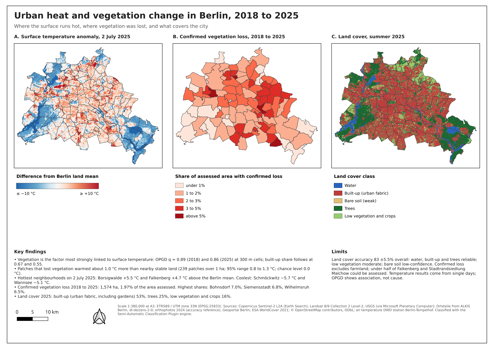

# Project 2 – Urban Heat and Vegetation Change Detection

**Status:** complete (Parts A to H, plus OPGD heat-driver analysis)
**Tools:** QGIS 4.2 · Semi-Automatic Classification Plugin (remotior-sensus engine) · Python (rasterio, NumPy, geopandas, scikit-learn) · STAC APIs · GeoPackage
**Question:** Where did vegetation change in Berlin between 2018 and 2025, how is surface heat distributed, and what is it most strongly associated with?
**Study area:** Berlin, 97 Ortsteile, 890.7 km², EPSG:25833.

## Key results

| Result | Value |
|---|---|
| Confirmed vegetation loss, 2018 to 2025 | 1,574 ha (1.97% of 79,813 ha assessed) |
| Vegetation increase (may be recovery from the 2018 drought) | 986 ha (1.24%) |
| Candidate change not confirmed by other dates | 990 ha (1.24%) |
| Farmland, reported separately because crop timing dominates | 3,805 ha |
| Highest share of confirmed loss | Bohnsdorf 7.0%, Siemensstadt 6.8%, Wilhelmsruh 6.5% |
| Largest confirmed loss by area | Marzahn 63 ha, Tegel 53 ha, Köpenick 50 ha |
| Berlin land surface mean | 34.1 °C (2018-07-23), 42.5 °C (2025-07-02) |
| Hottest neighbourhoods, 2025 | Borsigwalde +5.5 °C, Falkenberg +4.7 °C above the Berlin mean |
| Coolest neighbourhoods, 2025 | Schmöckwitz −5.7 °C, Wannsee −5.1 °C |
| Vegetation vs surface temperature | r = −0.83 (2018), −0.81 (2025) |
| Warming where vegetation was lost | +1.04 °C vs nearby stable land (95% range +0.83 to +1.25; chance level +0.01), 239 patches of at least 1 ha |
| Cooling where vegetation increased | −0.67 °C (95% range −0.91 to −0.44), 113 patches |
| Land cover accuracy | 83.3% ±5.5 (area-weighted), 247 independent points |

The 8.4 °C rise in the city mean matches an 8.4 °C rise in air temperature at Tempelhof on the two days. It is weather, not a warming trend, so dates are compared through anomalies from the Berlin mean.

## Data

| Dataset | Source | Licence or terms |
|---|---|---|
| Sentinel-2 L2A Collection 1, 2018-07-03 and 2025-07-01, plus extra dates for confirmation | Earth Search STAC (Copernicus) | Copernicus open data |
| Landsat 8/9 Collection 2 Level-2, surface temperature and reflectance | USGS, via Microsoft Planetary Computer | USGS public data |
| Ortsteile boundaries | ALKIS Berlin via WFS (from Project 1) | dl-de/zero-2-0 |
| Land use, buildings, roads | OpenStreetMap, Berlin extract 2026-11-02 | ODbL |
| ESA WorldCover 2021 | Planetary Computer | ESA WorldCover terms |
| Copernicus DEM GLO-30 (a surface model) | Planetary Computer | Copernicus DEM terms |
| Orthophotos 2018 and 2024 (reference only) | Geoportal Berlin WMS | Geoportal Berlin terms |
| Air temperature, Berlin-Tempelhof | DWD via Bright Sky API | DWD open data |

## Work completed

**Part A, setup.** Project in EPSG:25833, capped Python jobs outside QGIS because the VM has limited memory.

**Part B, imagery.** Selected near-cloud-free scenes (99.0% and 99.9% clear over Berlin) and streamed 10 bands from cloud-optimised GeoTIFFs. Reflectance offsets applied per band.

**Part C, band maths.** Instead of relying on NDVI and NDBI, used fully constrained spectral unmixing of all 10 bands at 20 m with shared endmembers. Built-up and soil were not separable by spectra in Berlin, so non-vegetated area was split using OSM land use. NDVI kept as a cross-check (r = 0.97).

**Parts D and E, change detection and neighbourhood summary.** A pixel counts as change only if vegetation moved by at least 15 points, the 10-band change magnitude is at least 0.10, and the same direction appears in at least 2 of 4 independent date pairs (three Sentinel-2 pairs and one Landsat pair).

**Audit of Parts D and E.** The first results were audited and rebuilt.
- Reproduced with separate code: raw to reflectance, unmixing (different solver), class map, neighbourhood table.
- Co-registration between dates: median 0.65 m. No tile seam.
- A blind check against aerial photos showed the first loss total was too high, and that most mapped gain is not structural change. This led to the confirmation rule above.

**Part F, land surface temperature.** Landsat Collection 2 Level-2 surface temperature at 30 m, cloud-masked, with anomalies from the Berlin land mean. The spatial pattern repeats on another date (r = 0.94).

**OPGD heat-driver analysis.** Optimal Parameters-based Geographical Detector (Song et al. 2020, doi 10.1080/15481603.2020.1760434) implemented in NumPy, because Heterra has no Linux version. Spatial block bootstrap for confidence intervals, plus a chance baseline for interactions.

| Factor (q at 300 m cells) | 2018 | 2025 |
|---|---|---|
| Vegetation fraction | 0.89 | 0.86 |
| Built-up share | 0.67 | 0.55 |
| Road share | 0.53 | 0.43 |
| Building share | 0.53 | 0.43 |
| Land use | 0.43 | 0.35 |
| Elevation | 0.19 | 0.14 |
| Shade | 0.06 | 0.11 |
| Soil | 0.05 | 0.13 |
| Distance to water | 0.04 | 0.05 |

300 m is a reasoned choice: about nine native 100 m thermal pixels per cell and about 8,700 cells. The standard selection rule found no optimum because q rises steadily with cell size (vegetation 0.83 at 120 m, 0.89 at 300 m, 0.92 at 1,200 m). Factor order is stable across sizes and dates (rank r = 0.98). Exact q values depend on cell size.

**Loss and heat.** Each patch of at least 1 ha was compared with stable land 90 to 300 m around it, using the change in surface temperature anomaly between the two dates. The same patch shapes moved 1 to 4 km onto stable land gave the chance level. Larger loss patches warmed more (+0.92 °C at 1 to 2 ha, +1.06 °C at 2 to 5 ha, +1.78 °C above 5 ha), and 82% of loss patches warmed relative to their surroundings. A second, partial Landsat pair from August agrees in direction (+0.83 °C loss, −0.88 °C increase).

**Part G, land cover classification.** Random Forest (200 trees) through the SCP engine, using 30 features: 10 bands from each of June, July and August 2025. Training pixels came from OSM, spectral filters and WorldCover, checked blind against aerial photos. The map went through three versions, each tested on new points:

| Version | Change | Overall accuracy (area-weighted) | Unweighted |
|---|---|---|---|
| 1 | July only, pure training pixels | 65.8% | 61.0% |
| 2 | Mixed urban pixels added to training | 79.9% | 63.3% |
| 3 (final) | June, July and August; bare soil means bare all summer | 83.3% | 71.7% |

| Class, final map | User's accuracy | Producer's accuracy | Mapped ha | Error-adjusted ha |
|---|---|---|---|---|
| Water | 0.94 | 1.00 | 4,902 | 4,602 |
| Built-up (urban fabric, including gardens) | 0.90 | 0.90 | 47,423 | 47,633 |
| Trees | 0.86 | 0.75 | 22,153 | 25,581 |
| Low vegetation and crops (moderate) | 0.55 | 0.69 | 13,818 | 10,997 |
| Bare soil (low confidence) | 0.33 | n/a (too few reference points) | 768 | 251 |

A second person labelled 30 reference points independently and agreed with the first on 19 of 29 usable points (kappa 0.55). Water agreed fully; soil, trees and low vegetation account for most differences.

**Part H.** A3 print layout in QGIS with three panels, exported to PDF and PNG.

## Limits

- Vegetation increase cannot be separated from recovery after the 2018 drought, so it is not reported as land change.
- Hectare totals depend on thresholds: mapped loss ranged from about 1,100 to 7,350 ha across the tested settings. Direction (more loss than gain) held at every setting.
- A blind check of 18 confirmed-loss points found visible structural loss at 8 of them. The sample is small, the 2018 photo was flown in early spring, and the latest photo is from 2024.
- Loss and heat: covers 38% of the loss area, because smaller patches are finer than the 100 m thermal sensor. It compares single days, and for increase patches the July and August results agree on average but not patch by patch (r = 0.07).
- Land cover reference labels come mainly from one interpreter, and a second person's independent check agreed on 66% of points, so the accuracy figures carry more uncertainty than their stated ranges. The photos predate the images, and each version was tested with its own reference views, so version comparisons are not exact. Of the sampled points mapped as bare soil, 23 of 49 are built-up, probably pale roofs and paving.
- OPGD shows association, not cause. Factors are correlated (vegetation vs built-up r about −0.82). Landsat emissivity uses NDVI, a small built-in link to vegetation. Elevation partly reflects tree canopy, and cells over 10% water were excluded, so waterfront cooling is not really tested.
- The OPGD code passed internal checks but has not been compared with a reference implementation.
- Temperature comes from single summer days at about 10:00 UTC, with about 2 °C pixel uncertainty. Change in anomalies between dates mixes weather and land state and is not reported as a finding.

## Skills practised

- **Remote sensing:** Sentinel-2 and Landsat Level-2 processing, cloud masking, spectral unmixing, change vector analysis, land surface temperature, multi-date confirmation
- **Classification:** training data design, Random Forest in SCP, stratified accuracy assessment, error-adjusted area estimates (Olofsson et al. 2014)
- **Spatial statistics:** Geographical Detector and parameter optimisation, block bootstrap, handling of scale effects
- **Data engineering:** STAC search, streaming COGs, memory-capped processing, resumable jobs
- **Validation:** independent re-derivation, blind reference labelling, sensitivity testing
- **Cartography:** multi-panel print layouts, classed and continuous legends

## CV-ready bullets

- Mapped vegetation change across Berlin (890 km²) from Sentinel-2, using 10-band spectral unmixing and confirming changes against independent dates and Landsat to reduce false detections.
- Audited my own change detection with independent re-computation and blind checks against aerial photos, then rebuilt it, reducing reported loss from 2,341 ha to a better-supported 1,574 ha.
- Implemented the Optimal Parameters-based Geographical Detector in Python and identified vegetation as the factor most strongly associated with land surface temperature (q = 0.86 to 0.89).
- Showed that patches losing vegetation warmed by about 1.0 °C relative to nearby stable land, using a placebo test to establish the chance level.
- Produced a 5-class multi-date land cover map with Random Forest in SCP, improving accuracy from 66% to 83% (±5.5, area-weighted) across three independently tested versions, and reporting class-level limits and error-adjusted areas.

## Outputs

- `urban_heat_vegetation_change.qgz`: QGIS project with all layers and the print layout
- `output/final_map.pdf`, `output/final_map.png`: final map
- `output/vegetation_change_confirmed_ortsteile.csv`: confirmed change per neighbourhood
- `output/lst_ortsteile.csv`: temperature per neighbourhood
- `output/opgd_factor_q_300m.csv`, `opgd_interactions_300m.csv`, `opgd_best_parameters_300m.csv`, `opgd_scale_selection.csv`: OPGD results
- `output/loss_heat_patches.csv`: temperature change per patch
- `output/landcover_v3_accuracy.csv`, `landcover_v3_error_matrix.csv`, `landcover_v3_accuracy_points.csv`: land cover accuracy
- `output/landcover_label_review.csv`: second-person label check
- `data/derived/`: rasters and GeoPackages
- `_work/`: all scripts and logs
- `WORKLOG.md`: step-by-step record, including crashes and decisions

Superseded files, kept for comparison, are in `_work/superseded/`: unconfirmed change results, the first two land cover maps and their accuracy tables, and the 1,200 m OPGD tables.
